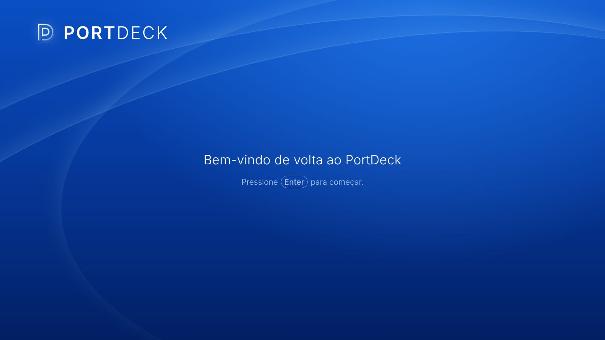
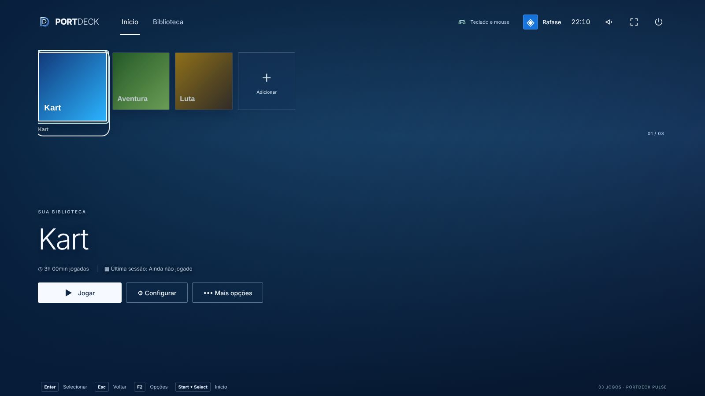
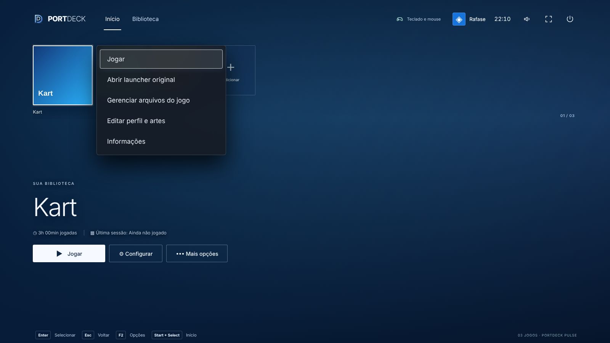
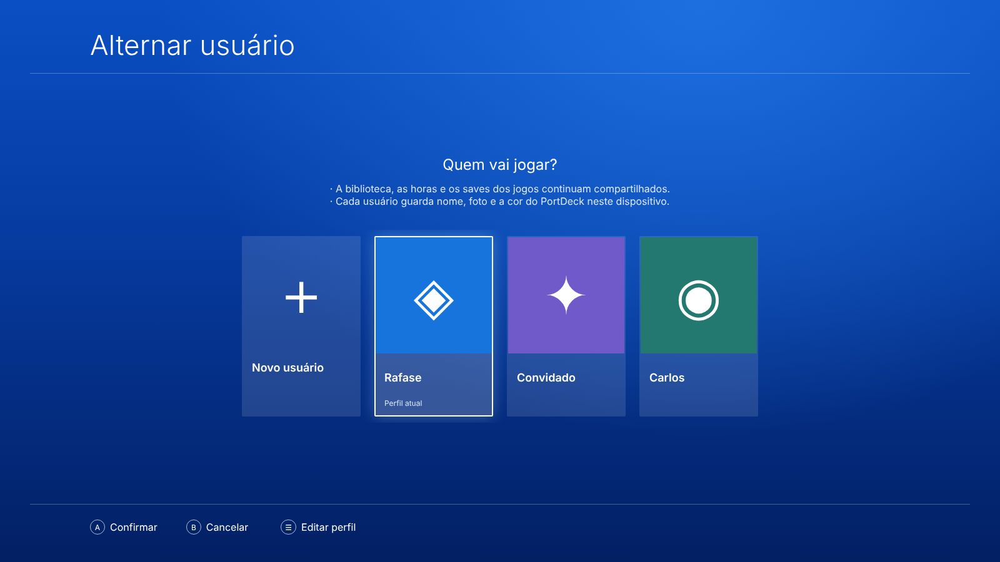
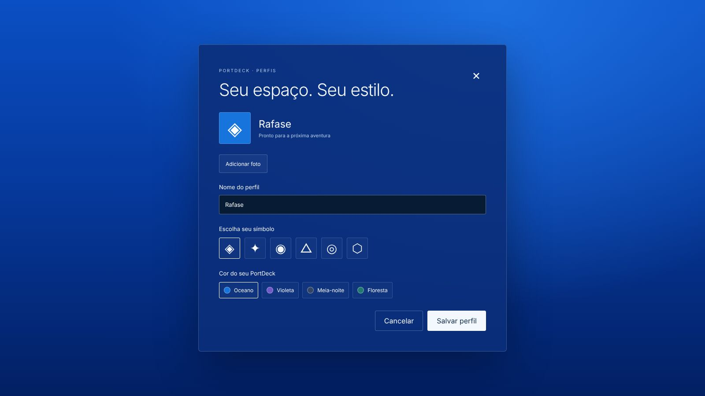

# PortDeck 0.8 — Usuários estilo PS4 e atualização por cima

Base: PortDeck 0.7 (branch `ccr-a064814d-udfijf`). Windows e Android Safe. Data: 20/10/2026.

## Pedido do dono
1. "Nunca dá para instalar por cima": cada APK novo exigia desinstalar o antigo.
2. A tela "Quem vai jogar?" não deve abrir sozinha ao iniciar. Trocar de usuário fica só para quando a pessoa quiser, como no PS4 ("Alternar usuário").
3. Cada atualização tem que ficar registrada com detalhes e fotos, para outra IA entender o que foi feito.

## O que mudou

### 1. Assinatura fixa do APK (instalar por cima)
- **Causa:** o CI gerava o APK de debug com a chave `~/.android/debug.keystore` criada do zero em cada máquina do GitHub Actions. Como a assinatura mudava a cada build, o Android recusava a atualização ("app não instalado") e obrigava a desinstalar.
- **Correção:** `android-source/portdeck-signing.keystore` (PKCS12, alias `portdeck`, senhas `portdeck`, validade de 100 anos; SHA-256 `ED:63:9D:51:DA:1A:29:0F:39:48:34:93:39:7B:0F:38:31:AB:8A:B2:98:C0:A9:73:47:5B:D0:3B:F2:6E:C7:65`). `scripts/prepare-android.cjs` injeta em `android/app/build.gradle` um `signingConfigs.debug` apontando para ela. Os dois APKs (padrão e Notificações) saem com a mesma assinatura.
- **Transição:** o APK da 0.8 ainda **não instala por cima da 0.7**, que tinha a chave aleatória antiga. É preciso desinstalar **uma última vez**, o que apaga a biblioteca e os perfis do tablet. Da 0.8 em diante, toda atualização instala por cima.
- **Segurança:** a chave está no repositório de propósito, porque o app é distribuído só por sideload e não está na Play Store. Quem tiver acesso ao repositório consegue assinar um APK aceito como atualização. Se um dia o app for publicado, troque por uma chave em segredo do GitHub (Secrets).
- **Não troque nem regenere esta chave**: isso quebraria a atualização por cima para todo mundo.

### 2. Sem "Quem vai jogar?" ao iniciar
- Fluxo novo: **entrada estilo PS4 → início direto, com o foco na capa selecionada**. No Android com biblioteca vazia, abre "Adicionar aplicativo Android".
- `PlayerProfiles` perdeu as props `startup`/`onWelcomeDone`. Windows (`src/ui/main.jsx`): `useEffect(()=>{if(!intro)focusShelf();},[intro])`. Android (`android-web/src/main.jsx`): `useEffect(()=>{if(!intro)offerFirstApp();},[intro])`. Valem para todas as saídas da entrada (toque, Enter e controle).
- Como trocar de usuário: tocar no avatar no topo, tecla **P** ou, no controle, **↑** a partir da fileira e depois **A**.

### 3. Tela "Alternar usuário" (inspirada no PS4)
`src/ui/components/PlayerProfiles.jsx` + estilos `.ps-users*` em `src/ui/dashboard.css`.
- Tela azul inteira, igual à da entrada. Título **"Alternar usuário"** à esquerda, com linha embaixo.
- No centro, "Quem vai jogar?" com duas observações (biblioteca, horas e saves compartilhados; cada usuário guarda nome, foto e cor).
- Fileira de cartões grandes: **"Novo usuário" (＋)** primeiro, depois um cartão por perfil, com a foto ou o símbolo na cor do tema, o nome e "Perfil atual". O cartão focado ganha contorno branco e brilho. Ao abrir, o foco vai para o usuário atual.
- Rodapé: **Ⓐ Confirmar · Ⓑ Cancelar · ☰ Editar perfil**. Editar age sobre o cartão focado; no controle, o botão Start/Options (`cmd==='menu'` em `profileCommand`) também edita.
- O formulário de edição (foto, nome, símbolo, cor) é o mesmo da 0.6, agora sobre o fundo azul. Esc/B ou × voltam para a lista; Esc/B na lista fecha.
- Escolher um cartão troca o usuário e fecha a tela. O modelo de dados (`portdeck-player-profiles-v1`) não mudou.

### 4. Ajustes menores
- O foco inicial do diálogo testa os seletores em ordem de prioridade (antes, `querySelector` com lista pegava o primeiro elemento do documento, que era "Novo usuário").
- O editor foca o primeiro botão, não o campo de nome, para não abrir o teclado do tablet sozinho.

## Telas (navegador, capas falsas)
| | |
|---|---|
|  |  |
|  |  |
|  | |

Referência usada: a tela "Alternar usuário" do PS4, enviada pelo dono (não versionada).

## Testes
- Unitários: 16/16.
- Playwright: 11/11. Os testes de navegador foram reescritos para o fluxo sem perfil na inicialização: a entrada espera o botão e vai direto para os jogos sem perguntar quem joga; a troca de usuário abre só com o avatar ou P, tem o cartão "Novo usuário", foca o usuário atual e Esc volta/fecha; edição com foto continua salva depois de recarregar; no Android, biblioteca vazia oferece app logo depois da entrada e a troca de usuário depois não reabre o seletor.
- A assinatura foi simulada localmente com um `build.gradle` de exemplo (script idempotente). O build real é conferido no workflow Android.

## Pendências
- Validar no tablet: instalar a 0.8 (desinstalando uma última vez), depois instalar um APK seguinte **por cima** e confirmar que mantém a biblioteca.
- Validar no tablet a nova tela de usuários com controle físico (↑ + A, Start para editar).
