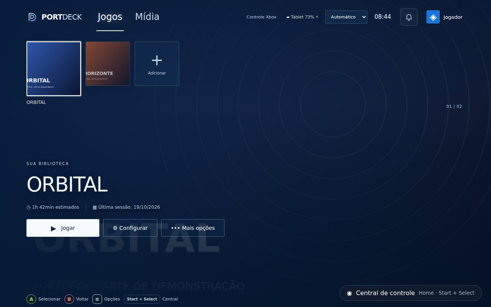
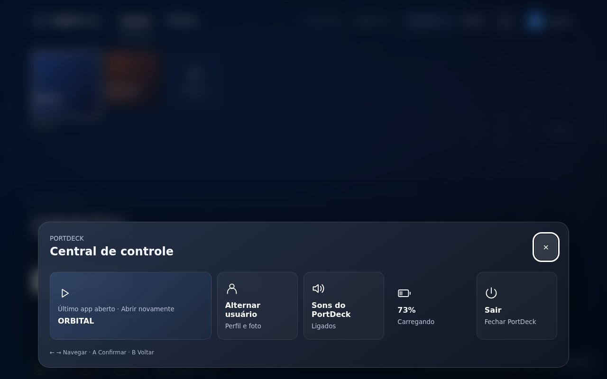
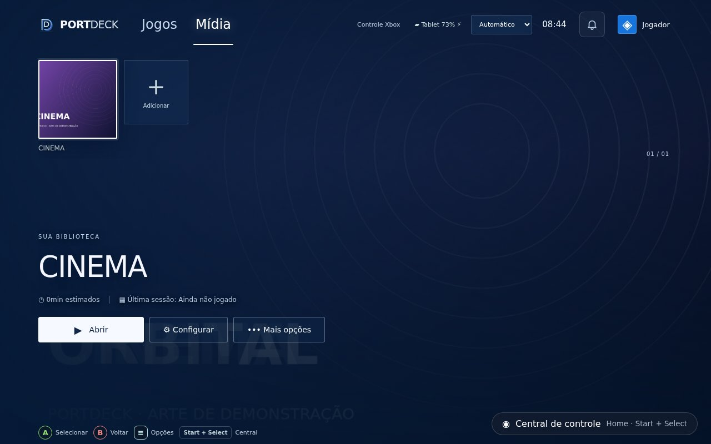
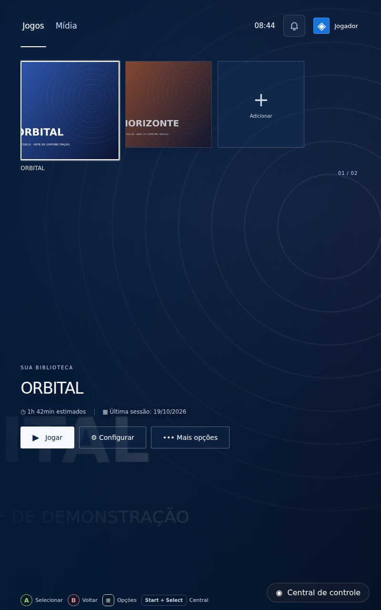
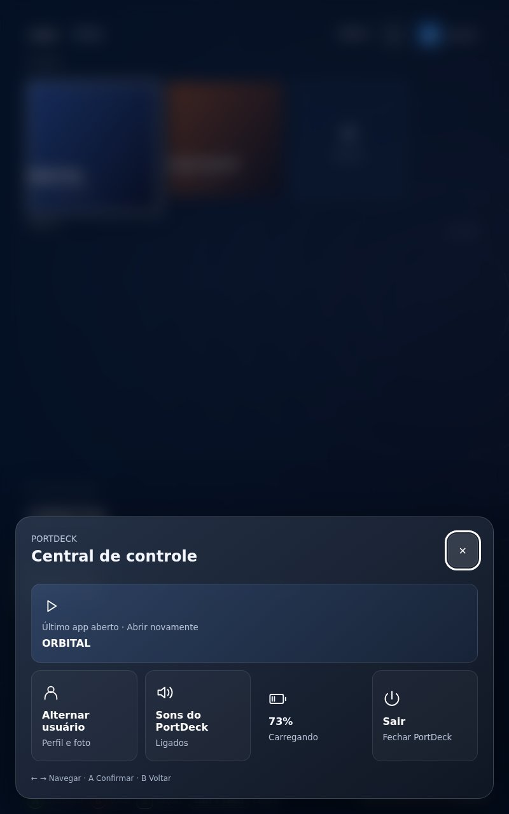
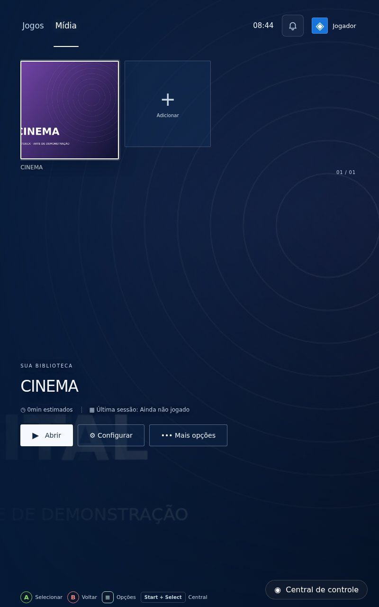
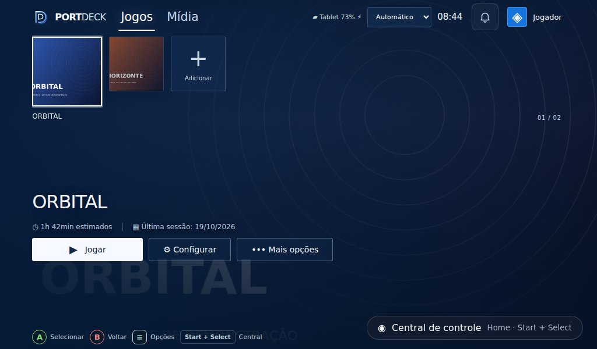
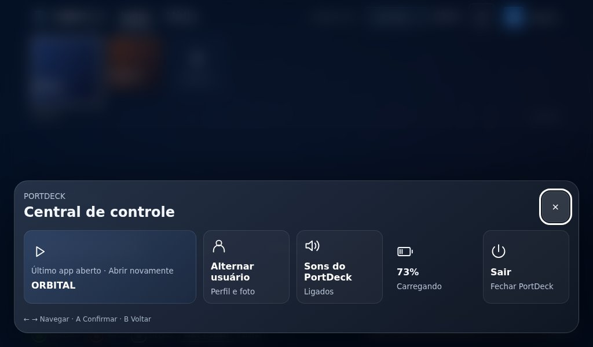
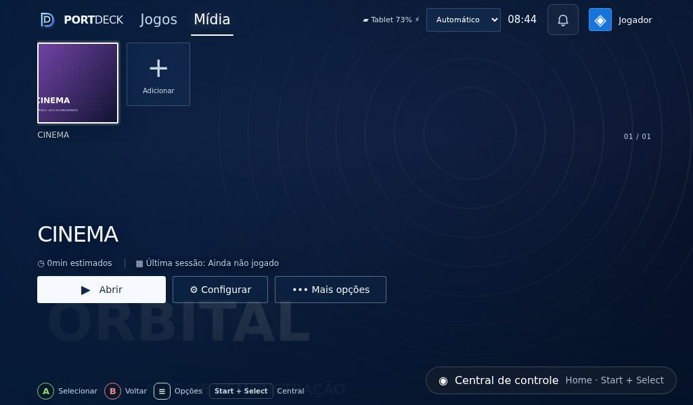

# PortDeck 0.9 — Central de controle e Jogos / Mídia

Base: 0.8, branch `ccr-a064814d-udfijf`, commit `6f55f1096e84599a859c0d2f8beeb5d607c6113e`. Branch desta versão: `feature/control-center-v0.9`. Windows e Android Safe.

## Pedido do dono
“Faça a versão 0.9 de uma vez”: corrigir prints do tablet, central estilo PS5 com Home ou Start+Select (jogo, usuário, som, bateria, sair); abas Jogos e Mídia, escolha ao adicionar, L1/R1; preservar os dados e instalar por cima. Testes, capturas e documentação obrigatórios.

**Anexos:** não chegaram novos prints da 0.8 nesta solicitação. O único print visível no histórico mostrava conflito na instalação de uma versão antiga. Não atribuímos correções a imagens que não pudemos inspecionar. Fizemos revisão própria em três formatos de tablet; comparar com os prints do dono fica pendente.

## O que mudou

### Central inferior
- Antes Home/Start+Select apenas voltava ao início. Agora abre/fecha a central inferior, com fundo desfocado, navegação direcional, A, B, Start, Tab/Shift+Tab, Escape, Home e toque. O botão fixo também dá acesso sem controle. Confirmação antes de sair.
- Novo `src/ui/components/ControlCenter.jsx`: `ControlCenter`, `centerCommand`, `CenterIcon`. Props `enabled`, `game`, `label`, `onGame`, `battery`, `charging`, `muted`, `onSound`, `onExit`, `onRestore`. Estilos `.control-center*`, `.center-items`, `.center-game`, `.center-battery` em `dashboard.css`. Animação curta desabilitada com movimento reduzido; painel com rolagem em alturas pequenas.
- Android: mostra o **último app aberto nesta sessão**, com ação de abrir novamente. Não finge detectar se outro processo ainda está rodando. `Native.launchApp` e o contador de tempo estimado continuam iguais. Bateria real do tablet vem de `PortDeckPlatform.getStatus`; nenhuma bateria de controle.
- Windows: mostra o primeiro jogo da lista de processos acompanhados por `api.running` / `onRunning`; o cartão abre seus detalhes, sem executar uma segunda instância. A ponte nativa `onHome` abre a mesma central. Sem API de bateria no Windows, mostra “Bateria indisponível”.
- “Sons do PortDeck” liga/desliga efeitos e abertura pela chave já existente `portdeck-sound`; não altera o volume de outros aplicativos. “Alternar usuário” abre o seletor existente, com fotos preservadas. Sair fecha somente o PortDeck.
- Home não descarta formulários abertos. No Android, botão Home físico só chega ao aplicativo se o driver o expuser e o PortDeck estiver em primeiro plano; não adicionamos acessibilidade nem substituímos o Home do sistema. Start+Select continua alternativa.

### Jogos e Mídia
- `LibraryTabs` e `categoryOf` no componente compartilhado; as duas interfaces agora exibem Jogos/Mídia no topo. L1 ou R1 alterna a aba, inclusive a partir do cabeçalho. Seleção/foco retornam à fileira da aba escolhida. Aba vazia permite adicionar por A.
- Novo campo opcional `category`: `games` ou `media`. Registros antigos, sem campo, aparecem em Jogos. A coleção completa continua salva: filtrar a tela nunca remove registros da outra aba.
- Android: escolha a aba no seletor de apps; o editor também permite mover um app existente sem removê-lo. `portdeck-android-library-v1` não mudou. Identificadores, pacote, atalho direto, atividades, horas, última sessão e artes continuam preservados por atualizações incrementais. IndexedDB `portdeck-android-art` / `images` e perfis `portdeck-player-profiles-v1` não mudaram.
- Windows: `normalizeGame` em `src/backend/library.cjs` preserva a categoria em `library.json`. Ao adicionar, usa a aba atual; o editor oferece a escolha antes de salvar a personalização. Não altera os executáveis nem os saves.
- `ConsoleHome` recebe `category`; Mídia usa “Abrir”, “Adicionar mídia” e mensagem própria quando vazia. As duas abas mantêm capas, banners, logos e menu contextual.

### Tablet, foco e acabamento
- Corrigido contorno duplo de foco causado por regras concorrentes sobre `.console-tile` e `.console-tile-art`; um único destaque fica na capa.
- Cabeçalho simplificado em telas menores; abas permanecem visíveis inclusive abaixo de 720 px, onde a regra antiga escondia a navegação inteira. Central reorganiza seus cartões e tem altura limitada ao viewport.
- Ícones da central são SVG locais, evitando glifos de fonte ausentes no aparelho. Sem recursos externos ou marcas Sony.
- Ícone pequeno do app não é mais ampliado como wallpaper no Android; banner/capa importados continuam disponíveis.
- `useDialogFocus` e `dialogCommand` dão foco contido, Escape/B e navegação no seletor/editor; fechar devolve foco à capa. Usuários longos rolam para o cartão focado, e sair da troca de usuário devolve foco à fileira.

### Atualização por cima e CI
- Mesmos `applicationId` **com.portdeck.pulse.safe** e arquivo **android-source/portdeck-signing.keystore**, sem qualquer alteração de bytes. Mesmo certificado SHA-256 `ED:63:9D:51:DA:1A:29:0F:39:48:34:93:39:7B:0F:38:31:AB:8A:B2:98:C0:A9:73:47:5B:D0:3B:F2:6E:C7:65`.
- `prepare-android.cjs` agora fixa `versionName 0.9.0` e `versionCode 9000` a partir do package.json (major × 1.000.000 + minor × 1.000 + patch), de forma idempotente. A 0.8 gerada pelo Capacitor tinha código 1.
- `verify-apk.cjs`, executado antes do upload de **cada variante**, verifica com apksigner/aapt certificado, pacote, versão, ausência de HOME/acessibilidade e presença do leitor de notificações somente na variante opcional. Um APK incompatível falha o CI.
- Workflows incluem a branch nova, artefatos v0.9 e Playwright 1.56.1 fixado para repetibilidade. Java nativo e permissões do APK padrão não foram alterados.
- Instalar **por cima da 0.8**, sem desinstalar. Não há conversão destrutiva de dados. Chaves aleatórias de versões anteriores à 0.8 continuam incompatíveis; a 0.9 não pode recuperar uma chave privada antiga inexistente.

## Telas (Playwright, capas fictícias)

| Formato | Jogos | Central | Mídia |
|---|---|---|---|
| 1280 × 800 |  |  |  |
| 800 × 1280 |  |  |  |
| 1024 × 600 |  |  |  |

Reproduzir: `npm run build` e `PORTDECK_SCREENSHOTS=1 npx playwright test`. As capas ORBITAL, HORIZONTE e CINEMA são desenhadas por canvas no fixture; nenhuma imagem de referência da Sony foi incluída.

## Testes
- `npm test`: **18/18** (inclui compatibilidade da categoria e preparação Android idempotente preservando chave/pacote).
- Builds Vite Windows e Android: concluídos.
- Playwright: suíte de regressão da 0.8 **11/11**; novos testes **7/7**, abrangendo Home, Start+Select, L1/R1, foco, som, usuário, seleção de aba ao adicionar, mover app, reiniciar preservando dados, bateria simulada, último app e confirmação de saída; três tamanhos de tablet.
- Capturas inspecionadas visualmente; sem simular instalação física como se tivesse ocorrido.
- Validação dos APKs reais: registrada no workflow Android, antes dos dois uploads. Consultar a execução do commit entregue.

## Pendências no aparelho
- Instalar sobre a 0.8 e conferir biblioteca, fotos, horas e atalhos reais. A assinatura e os metadados são verificados no CI; o tablet não está conectado a este ambiente.
- Confirmar Home exposto pelo driver, Start+Select, L1/R1, teclado virtual e troca de usuário no controle físico.
- Reenviar os prints mencionados para comparar os problemas específicos que não ficaram disponíveis nesta conversa.
- Notificações reais Android 14+ seguem dependentes de permissão explícita e da variante opcional. APK padrão continua sem leitor de notificações.
