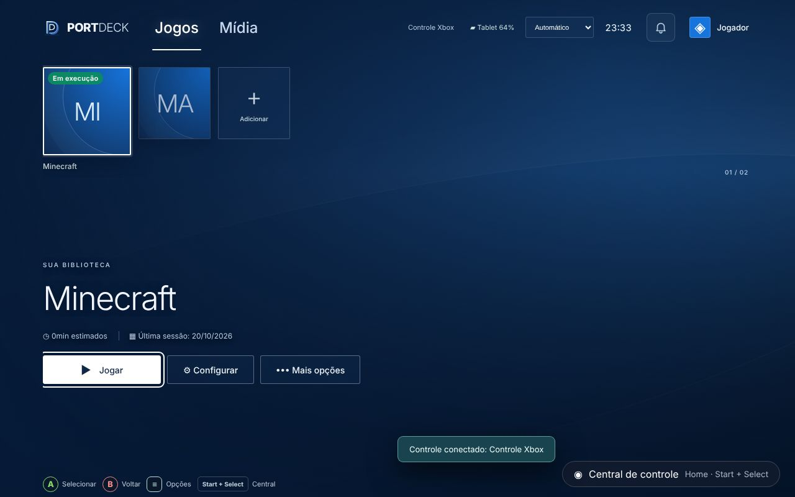
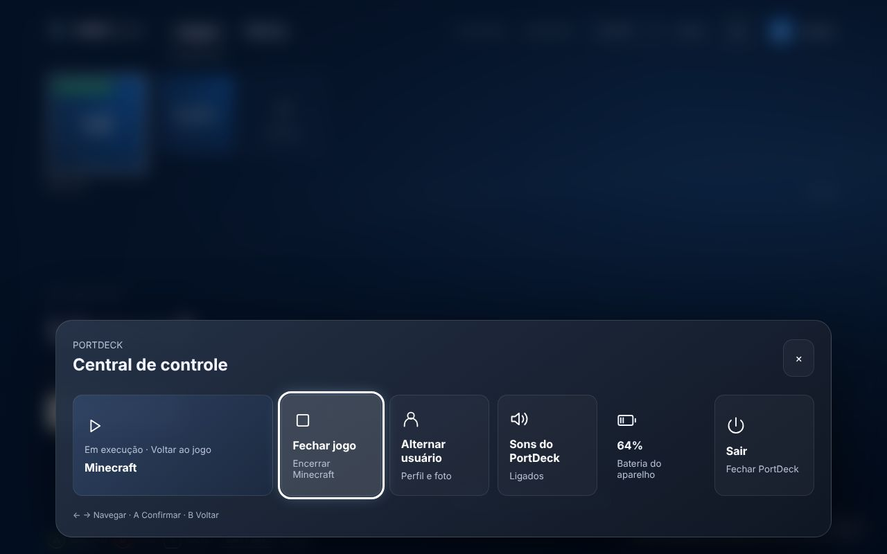
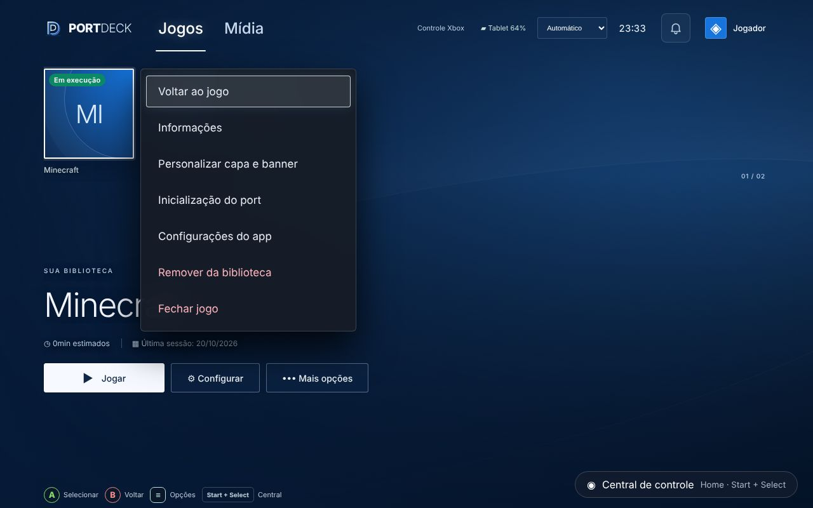
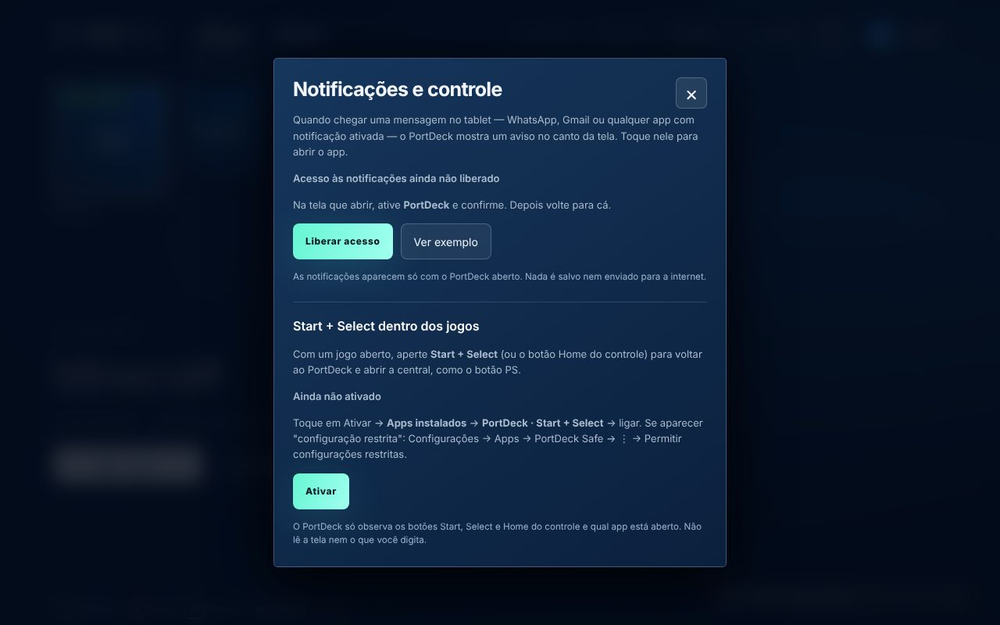
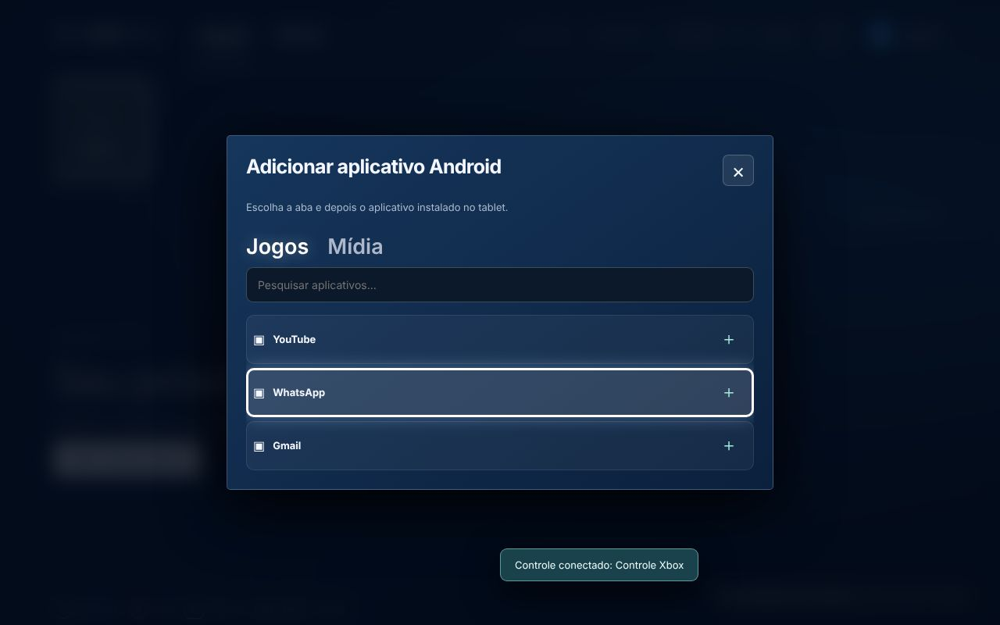
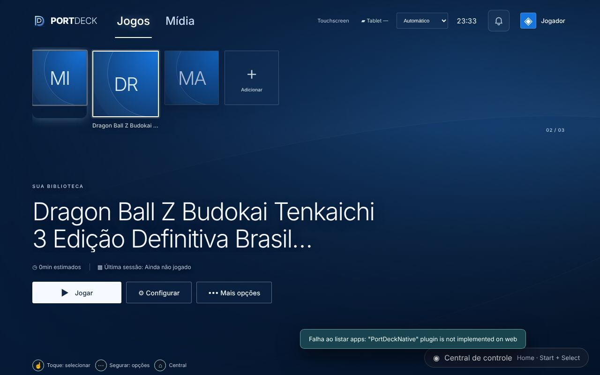

# PortDeck 1.0 — Controle de verdade e jogo aberto

Base: 0.9 (`feature/control-center-v0.9`, commit `420b6eb`). Branch desta versão: `ccr-a064814d-udfijf` (fast-forward da 0.9 + commits da 1.0). Windows e Android Safe. Data: 20/10/2026.

## Pedido do dono (testando a 0.9 no tablet, com prints)
1. Na central de controle não dá para escolher as opções pelo controle e não aparece onde está o foco ("a luzinha em volta").
2. O PortDeck não sabe quando um jogo está aberto, então não aparece a opção de fechar o jogo.
3. Start + Select **dentro do jogo** deve voltar ao menu do PortDeck.
4. Nome muito grande deixa a capa enorme.
5. Não dá para navegar pelo controle na lista "Adicionar aplicativo Android".
6. "Depois disso fica meio que finalizado": por isso esta é a **1.0**.

## Causas e correções

### 1 e 5. Navegação por controle na central e na lista de apps
- **Causa:** o foco só tinha destaque com `:focus-visible`, que o Chromium/WebView desliga quando a última interação foi toque, então quem usa controle não via onde estava. A central começava com o foco no **×**: apertar A fechava a central e parecia que o controle não funcionava. Na lista de apps, a navegação linear passava pela caixa de pesquisa, o que abria o teclado do tablet e prendia o controle ali.
- **Correção** (`src/ui/components/ControlCenter.jsx`):
  - `markPad()` coloca a classe `pad-nav` no `<html>` quando chega um comando do controle (loops de gamepad em `src/ui/main.jsx` e `android-web/src/main.jsx`) ou quando o teclado usa setas, Tab ou Enter. Qualquer `pointerdown` remove a classe.
  - Estilos `.pad-nav … :focus` em `src/ui/dashboard.css` mostram contorno branco com brilho. Na lista de apps o contorno é interno (`outline-offset:-3px`) para não ser cortado.
  - `padTargets()` é usado por `centerCommand` e `dialogCommand` e deixa fora da navegação os campos de texto (`input`/`textarea` que não sejam file, range, checkbox ou radio) e os elementos ocultos. A pesquisa continua funcionando pelo toque.
  - A central abre com o foco no **primeiro cartão** (`.center-items button:not(:disabled)`), nunca no ×. Sem foco atual, o primeiro comando de direção vai para o primeiro item.

### 2. Jogo aberto e Fechar jogo
- **Android** (`android-web/src/main.jsx`):
  - O estado `running` (`{id,packageName,name,since}`) é salvo em `localStorage` na chave **`portdeck-android-running-v1`** e expira em 12 h.
  - Ao abrir um jogo pelo PortDeck, ele passa a "Em execução". O estado só sai quando o jogador fecha pelo PortDeck ou abre outro jogo.
  - O Android não avisa outros apps quando um jogo é fechado pela lista de recentes. Nesse caso o selo continua, e "Fechar jogo" de novo não causa problema.
  - **Nativo:** `PortDeckNativePlugin.closeApp({packageName})` chama `ActivityManager.killBackgroundProcesses`. A permissão comum `KILL_BACKGROUND_PROCESSES`, que não é sensível, foi adicionada pelo `prepare-android.cjs` nos dois APKs. O app só pode ser encerrado em segundo plano, que é o caso quando o PortDeck está na frente.
- **Interface compartilhada:**
  - `ControlCenter` ganhou a prop `onCloseGame`. O cartão do jogo vira "Em execução · Voltar ao jogo" e aparece o cartão **Fechar jogo** (`.center-close-game`, ícone `stop`). O grid se ajusta com `:has()`.
  - `ConsoleHome`/`GameTile` ganharam a prop `runningIds` e o selo verde **"Em execução"** (`.console-tile-running`).
  - No menu ao lado da capa, "Jogar" vira **"Voltar ao jogo"** e aparece **"Fechar jogo"**.
- **Windows:** já sabia quais processos estão abertos (`api.running`). Agora a central também tem **Fechar jogo**, que usa o mesmo fluxo de encerramento do menu (`beginClose`).

### 3. Start + Select dentro do jogo (Android)
- **Limite do Android:** um app não recebe os botões do controle quando outro app está na frente. A única forma permitida é um **serviço de acessibilidade** com filtro de teclas, e o Play Protect bloqueia isso em apps fora da loja, igual ao leitor de notificações.
- **Por isso fica só no APK opcional**, que passou a se chamar **"Completo"** (artefato `PortDeck-Android-Safe-v1.0-Completo-APK`, gerado com `PORTDECK_NOTIFICATIONS=1`). O APK padrão continua sem acessibilidade.
- `android-source/PortDeckGamepadService.java`:
  - Observa `TYPE_WINDOW_STATE_CHANGED`, só para saber qual pacote está na frente, e os botões `BUTTON_START`, `BUTTON_SELECT` e `BUTTON_MODE` (Home do controle).
  - Com outro app na frente, Start+Select (ou Home) abre a `MainActivity` com o extra `portdeck.home` (com intervalo mínimo de 800 ms entre disparos). As outras teclas passam direto para o jogo, e com o PortDeck na frente o serviço não interfere.
  - Configuração em `res/xml/portdeck_gamepad.xml` (`canRetrieveWindowContent=false`) e textos em `res/values/portdeck_strings.xml`.
- `PortDeckNotificationsPlugin`: `handleOnNewIntent` emite o evento `homeButton`. Os métodos `gamepadStatus()` (disponível e ativado, via `ENABLED_ACCESSIBILITY_SERVICES`) e `openGamepadSettings()` dão suporte à interface.
- **Interface** (`android-web/src/Notifications.jsx`): `useGamepadAccess` e `GamepadAccessSettings`. O sininho abre "Notificações e controle" com a seção **"Start + Select dentro dos jogos"**: estado, botão Ativar e instruções, incluindo "Permitir configurações restritas". Ao receber `homeButton`, o PortDeck volta ao início e abre a central (Voltar ao jogo / Fechar jogo).
- `scripts/verify-apk.cjs` agora lê a versão do `package.json` e exige `BIND_ACCESSIBILITY_SERVICE` e `BIND_NOTIFICATION_LISTENER_SERVICE` **só** no Completo. O APK padrão falha no CI se tiver qualquer um dos dois.
- **Windows:** já funcionava pela ponte XInput (`InputBridge`) e agora abre a central.

### 4. Nome longo
- **Causa:** `.console-tile` é item flex com `min-width:auto`. Com a legenda em `white-space:nowrap`, a largura mínima passava a ser a do texto e a capa selecionada esticava.
- **Correção:** `.shell .console-tile{min-width:0}`. A legenda corta com "…" e o título grande (`.console-story h1`) fica limitado a 2 linhas.

### Versão
- `package.json` passa para 1.0.0, o que gera `versionCode 1000000` (maior que o 9000 da 0.9) com a mesma chave `portdeck-signing.keystore`, então **instala por cima da 0.8/0.9**.
- Artefatos: `PortDeck-Android-Safe-v1.0-APK`, `PortDeck-Android-Safe-v1.0-Completo-APK` e `PortDeck-Windows-v1.0.0`.

## Telas (Playwright, capas fictícias, controle simulado)
| | |
|---|---|
|  |  |
|  |  |
|  |  |

Prints do dono na 0.9, descritos aqui e não versionados: a central sem indicador de foco (com "Último app aberto · Chrome"), a lista "Adicionar aplicativo Android" com Jogos/Mídia e apps do tablet, e o início com Dragon Ball/Minecraft/Mario Kart.

## Testes
- `npm test`: **18/18**. `tests/android-build.test.cjs` agora lê a versão do `package.json`, exige `KILL_BACKGROUND_PROCESSES` e confirma que o APK padrão não tem acessibilidade nem leitor de notificações e que o Completo tem os dois.
- Playwright: **24/24**. Os 5 testes novos em `tests/browser/v1.spec.mjs` usam controle simulado via `navigator.getGamepads` e plugins Capacitor simulados:
  - foco da central começa num cartão, fica visível e alcança todas as opções; A em "Alternar usuário" abre a tela;
  - a lista de apps pelo controle nunca foca a pesquisa e adiciona o app escolhido;
  - o selo "Em execução" continua depois de recarregar; o menu mostra Voltar/Fechar; a central fecha o jogo chamando `closeApp` com o pacote certo e limpando o estado;
  - o evento `homeButton` abre a central, e o botão Ativar abre as configurações de acessibilidade;
  - nome longo não estica a capa e o título fica em até 2 linhas.
- Os 5 testes novos **falham na 0.9 e passam na 1.0**. Um teste da 0.9 foi atualizado porque o texto "Último app aberto" virou "Em execução" de propósito.
- O Java novo (`closeApp`, `PortDeckGamepadService`, métodos do plugin) só é compilado no CI. Confira o workflow Android da entrega.

## Pendências no aparelho
- Instalar por cima da 0.9 sem perder os dados (primeira atualização real com a chave fixa).
- Navegar com o controle físico na central e na lista de apps.
- "Fechar jogo" no Minecraft: confirmar que o jogo realmente fecha. Alguns jogos com serviço em primeiro plano podem resistir; nesse caso há o caminho Configurações do app → Forçar parada.
- APK Completo: ativar "PortDeck · Start + Select" em Acessibilidade e testar Start+Select dentro de um jogo com o controle usado (8BitDo, Xbox ou PS). O serviço também aceita `KEYCODE_BACK` vindo do controle como Select (comum no 8BitDo); se mesmo assim não funcionar, registrar o modelo.
