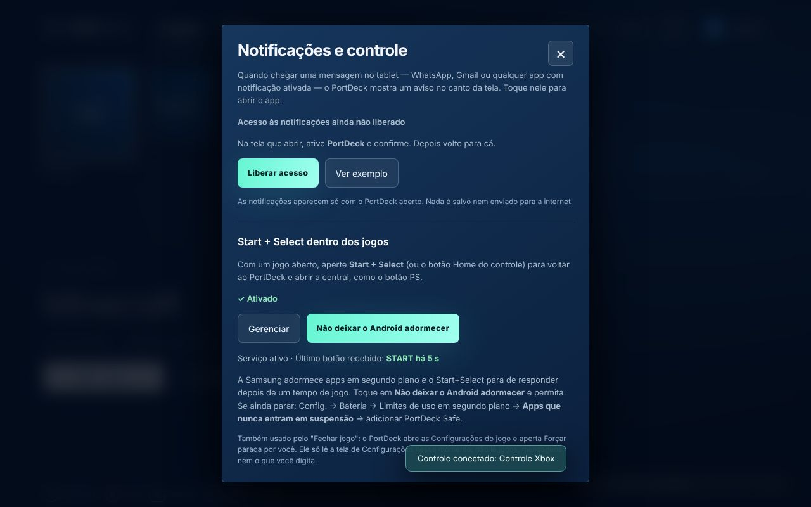
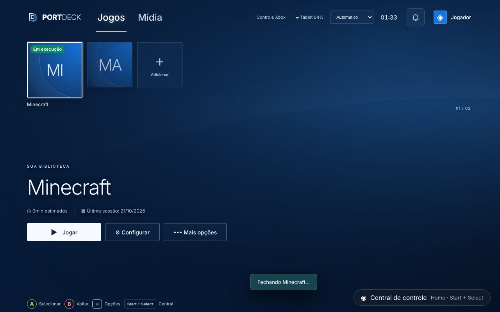

# PortDeck 1.1 — Fechar jogo de verdade e Start+Select confiável

Base: 1.0 (`ccr-a064814d-udfijf`, commit `8b01c94`). Android (o Windows não mudou). Data: 21/10/2026.

## Pedido do dono (testando a 1.0 no tablet Samsung, APK Completo, acessos liberados)
1. "Fechar jogo" aparece, mas não fecha o jogo (Minecraft e outros). Funcionou uma vez e depois não.
2. Start+Select dentro do jogo funciona no primeiro minuto e **depois de um tempo para de reconhecer**.
3. Para chegar até aqui, ele precisou liberar **"Permitir configurações restritas"** (Config. → Aplicativos → PortDeck Safe → ⋮), porque o Android bloqueava ativar a acessibilidade (print "Configuração restrita").

## Causas
- **Fechar jogo:** `ActivityManager.killBackgroundProcesses` é só um pedido. O Android/One UI ignora quando o jogo ainda tem tarefa nos recentes ou serviço ativo, por isso funcionou uma vez só. App comum não tem como encerrar outro app.
- **Start+Select parando:** duas causas prováveis, as duas tratadas:
  1. O serviço decidia que "o PortDeck está na frente" pelo último evento `TYPE_WINDOW_STATE_CHANGED`. Sobreposições da Samsung/do jogo e o próprio PortDeck em segundo plano podiam deixar esse valor errado, e então o serviço passava a ignorar o combo.
  2. A Samsung adormece apps em segundo plano por economia de bateria. Isso é um problema conhecido de serviços de acessibilidade na One UI.
  Além disso, se o Android encerrava o processo do PortDeck durante o jogo, o Start+Select abria o app "a frio", caía na tela de entrada e o pedido de abrir a central se perdia.

## O que mudou
### Fechar jogo (Forçar parada)
- `PortDeckNativePlugin.closeApp` continua chamando `killBackgroundProcesses` e depois:
  - **APK Completo com o serviço ativo** → `PortDeckGamepadService.requestClose(pkg)`, que devolve `{mode:'auto'}`.
  - **Caso contrário** → abre `ACTION_APPLICATION_DETAILS_SETTINGS` do jogo e devolve `{mode:'manual'}`. A interface avisa: *Toque em "Forçar parada" para fechar X.*
- `PortDeckGamepadService` (modo automático):
  1. abre Informações do app (`NO_HISTORY`, `EXCLUDE_FROM_RECENTS`);
  2. procura **"Forçar parada"** (também "Forçar fechamento", "Forçar encerramento" e "Force stop") no `getRootInActiveWindow()` da tela de Configurações e clica no item clicável que o contém. Se o botão estiver desativado, o jogo já estava parado;
  3. confirma no diálogo ("OK" ou o mesmo texto em botão);
  4. dá voltar e reabre o PortDeck.
  O limite de tempo é de 6 s. Se falhar, a tela de Configurações fica aberta para o toque manual.
  O resultado vai para a interface pelo evento `closeResult` do `PortDeckNotificationsPlugin` (`closeResult(pkg, ok)`).
- `res/xml/portdeck_gamepad.xml`: `typeWindowStateChanged|typeWindowContentChanged` e **`canRetrieveWindowContent="true"`**. O serviço só lê a árvore da tela quando há um "Fechar jogo" em andamento e o pacote do evento é de Configurações; fora disso retorna logo na primeira linha. A descrição em `portdeck_strings.xml` explica isso ao usuário.
- Interface (`android-web/src/main.jsx`): no modo `auto`, o selo "Em execução" só sai quando chega `closeResult` com `ok` (aviso "Fechando X…" e depois "Jogo fechado."). Sem confirmação, a interface pede o toque em "Forçar parada".

### Start+Select confiável
- `MainActivity.resumed` (`onResume`/`onPause`) substitui o rastreio por eventos de janela: com o PortDeck na frente, o serviço não interfere; fora dele, sempre trata o combo. Depois de disparar, o estado de Start/Select volta a zero, para não ficar "preso".
- **Abertura a frio:** `MainActivity.pendingHome` guarda o extra `portdeck.home` no `onCreate`, e o novo método `PortDeckNotificationsPlugin.consumeHome()` é lido pela interface ao carregar. A entrada é pulada e a central abre. Para abrir a central só depois que a entrada sai, a interface usa o estado `centerRequest`.
- **Bateria (só no Completo):** permissão `REQUEST_IGNORE_BATTERY_OPTIMIZATIONS` (adicionada pelo `prepare-android.cjs` apenas com `PORTDECK_NOTIFICATIONS=1`) e método `openBatterySettings()`, que abre o pedido do Android com Informações do app como alternativa. `gamepadStatus()` agora também devolve `connected`, `lastKey`, `lastKeyAt` e `batteryFree`.
- **Diagnóstico** (`GamepadAccessSettings` em `android-web/src/Notifications.jsx`, atualizado a cada 1,5 s com a janela aberta): mostra "Serviço ativo/parado · Último botão recebido: START há 5 s", o botão **"Não deixar o Android adormecer"** e, se ainda parar, o caminho Samsung *Bateria → Limites de uso em segundo plano → Apps que nunca entram em suspensão*.

### Versão
1.1.0, versionCode 1001000, mesma chave. Artefatos `PortDeck-Android-Safe-v1.1-APK`, `PortDeck-Android-Safe-v1.1-Completo-APK` e `PortDeck-Windows-v1.1.0` (sem mudança funcional no Windows).

## Telas
| | |
|---|---|
|  |  |

Print do dono descrito aqui e não versionado: Config. → Acessibilidade → Aplicativos instalados → "PortDeck · Start + Select · Desativado" com o diálogo "Configuração restrita".

## Testes
- `npm test`: 18/18. `android-build.test.cjs` confirma que a permissão de bateria só existe no Completo e que o XML de acessibilidade lê conteúdo de janela.
- Playwright: 28/28, com 4 testes novos em `tests/browser/v1.spec.mjs`:
  - no Completo, Fechar jogo mantém "Em execução" até `closeResult` ok;
  - no APK normal, o aviso manda tocar em "Forçar parada";
  - a abertura a frio por Start+Select pula a entrada e abre a central;
  - o diagnóstico mostra o último botão e o pedido de bateria chama `openBatterySettings`.
- A automação do "Forçar parada" (textos e cliques da One UI) só pode ser validada no aparelho; o Java compila no CI.

## Pendências no aparelho
- Fechar jogo no Minecraft pelo Completo: a tela de Configurações deve piscar e o PortDeck voltar com "Jogo fechado." Se não fechar, mandar print da tela "Informações do app" do jogo (o texto do botão pode ser diferente na sua versão da One UI).
- Start+Select depois de 10–20 min de jogo, com "Não deixar o Android adormecer" permitido. Se parar, abrir o sininho e conferir se o diagnóstico diz "Serviço parado" e qual foi o último botão recebido.
