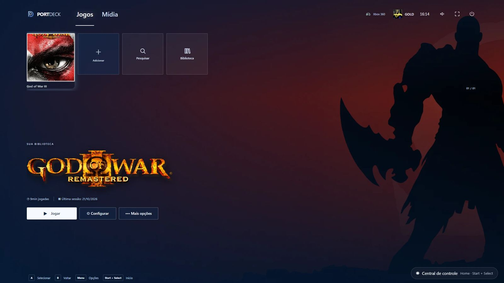
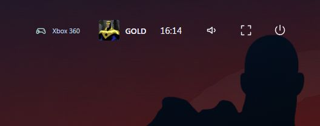

# PortDeck 1.2.1 — Controle alcança tudo no Windows

Base: 1.2 (`ccr-a064814d-udfijf`, commit `df9eb94`). Primeiro teste do dono num **PC Windows** (controle Xbox 360). Data: 21/10/2026.

## Pedido do dono
- No Windows, com o controle, **não dava para chegar em "Adicionar"** na fileira (nem Pesquisar/Biblioteca).
- No topo, o controle **só chegava no perfil**; som, tela cheia e desligar ficavam inalcançáveis.
- O restante funcionou: início com arte em tela cheia, logo do God of War, 9 min jogadas, perfil "GOLD" com foto e Xbox 360 detectado.

## Causa
- `jump()` em `src/ui/main.jsx` navegava só pela lista de jogos (`visibleIds`); os cartões Adicionar, Pesquisar e Biblioteca ficavam fora.
- Na zona `header`, o controle só tratava A, ↓ e B, sem ← →. No teclado, as setas no cabeçalho eram ignoradas.
- No Android o problema era o mesmo para Pesquisar e Biblioteca (Adicionar já funcionava pelo `ADD_ID`).

## O que mudou
- `ConsoleHome.jsx` exporta três funções novas:
  - `shelfStep(delta)`: percorre a fileira **na ordem da tela** (capas → Adicionar → Pesquisar → Biblioteca; com a pesquisa aberta, entra no campo);
  - `isShelfExtra(el)`;
  - `headerStep(delta)`: percorre todos os `button` visíveis do `.header`, ou seja, abas, perfil, som, tela cheia e sair no Windows, e abas, sininho e perfil no Android.
- **Windows** (`src/ui/main.jsx`):
  - `jump` usa `shelfStep`: capa atualiza `selected`, os outros cartões recebem foco direto;
  - `activate` aperta o cartão focado (Adicionar, Pesquisar, Biblioteca);
  - na zona `header`, ← → usam `headerStep` e A aperta o botão focado;
  - no teclado, ← → no cabeçalho também usam `headerStep`.
- **Android** (`android-web/src/main.jsx`): `shift` usa `shelfStep` (Adicionar continua como `ADD_ID`), `activate` aperta Pesquisar/Biblioteca, ← → no cabeçalho usam `headerStep` e A aperta qualquer botão do cabeçalho.

## Telas do PC do dono (antes da correção)
| | |
|---|---|
|  |  |

## Testes
- `npm test`: 18/18.
- Playwright: **36/36**, com 2 novos em `tests/browser/windows-pad.spec.mjs` (controle Xbox 360 simulado):
  - → depois do último jogo passa por Adicionar (A chama `api.add`), Pesquisar e Biblioteca (A abre a Biblioteca);
  - ↑ vai ao perfil, ← → alcançam som, tela cheia e sair, A em tela cheia chama `toggleFullscreen` e ↓ volta à capa.

## Pendências
- Testar no PC: adicionar um jogo pelo controle, Pesquisar (Y), central (Start+Select) e Fechar jogo.
