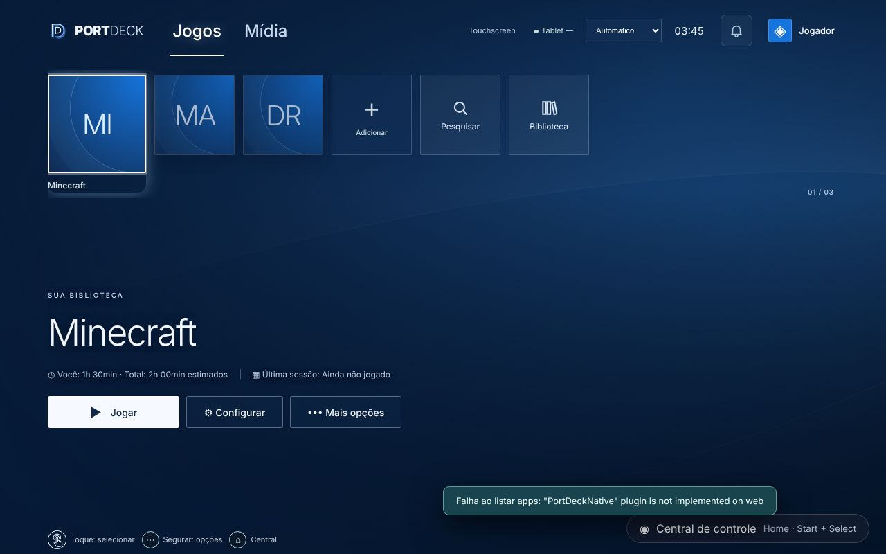
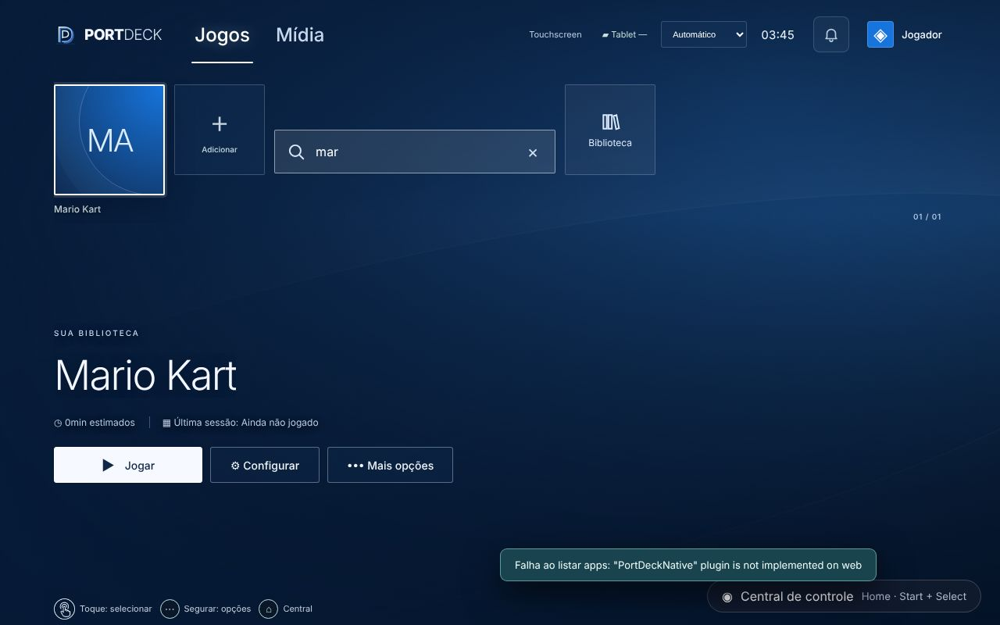
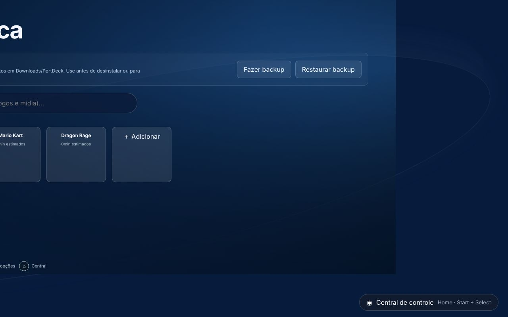

# PortDeck 1.2 — Pesquisa, horas por usuário, backup e sons

Base: 1.1 (`ccr-a064814d-udfijf`, commit `1cdc7a9`). Android e Windows. Data: 21/10/2026.

## Pedido do dono (depois de testar a 1.1 no tablet, APK Completo)
- **Funcionou:** Start+Select está perfeito mesmo depois de muito tempo de jogo (a liberação de bateria resolveu) e as horas estão sendo contadas.
- **Ícone de toque:** ele desenhou um ícone (círculo + mão com ondas) para substituir o emoji ☝ da dica "Toque: selecionar".
- **Fechar jogo:** funcionou várias vezes, inclusive com apps que não são jogos, e **depois parou de fechar**.
- **Pesquisa:** no início, um quadrado para pesquisar **só os jogos**; na Biblioteca, uma pesquisa de **tudo o que foi adicionado**.
- **"Faz as outras atualizações"** sugeridas: horas por usuário, backup e sons.

## O que mudou

### Ícone de toque
`android-web/src/assets/touch-hint.png` (96×96, transparente) foi recortado do desenho do dono (original em `docs/screenshots/1.2/icone-toque-original.png`). `ButtonGlyph` em `android-web/src/ControlHints.jsx` usa o ícone para `layout==='touch'` + `action==='accept'` (classe `.pd-glyph-touch-icon`).

### Fechar jogo parava depois de algumas vezes (APK Completo)
Três causas encontradas em `android-source/PortDeckGamepadService.java`:
1. **Tela velha reaproveitada:** quando uma tentativa falhava, a tela de Configurações ficava na tarefa do app Configurações. Na próxima, o Android trazia essa tarefa de volta, às vezes na página de **outro app**. O serviço então apertava o botão errado ou achava que o jogo "já estava parado". Agora a tela abre com `FLAG_ACTIVITY_CLEAR_TASK`, e o serviço só age se o **nome do app certo** aparece na tela (`hasText(root, closingLabel)`).
2. **Confirmação cedo demais:** o texto "Forçar parada" também é o do botão da página. O passo 2 só aceita o botão de confirmação depois que a janela muda (`root.getWindowId() != firstWindow`) ou depois de 2,5 s.
3. **Tempo esgotado antigo cancelava a tentativa nova:** cada tentativa tem um `token`, e o tempo esgotado (7,5 s) só vale para a própria tentativa.

O diagnóstico do sininho mostra também "Último Fechar jogo: <app>: fechado / já estava parado / tempo esgotado no passo N" (`PortDeckGamepadService.lastClose`, campo `lastClose` em `gamepadStatus()`).

### Pesquisa
- **Fileira (início):** cartão **Pesquisar** (`.console-search`) depois de "Adicionar" em `ConsoleHome`, com as props novas `query`/`onQuery`. Ao abrir, vira um campo (`.console-search-open`). A fileira mostra só os itens **da aba atual** (Jogos ou Mídia) que batem com o texto, e o primeiro resultado é selecionado.
  - As setas e o controle navegam só pelos resultados: `visibleIds` em `current.current` (Android) e `stateRef.current` (Windows).
  - Enter vai para a capa, Esc ou × limpa.
  - No controle, **Y / △** (`cmd==='options'`) abre a pesquisa.
  - Trocar de aba limpa a pesquisa.
- **Biblioteca:** cartão **Biblioteca** (`.console-library`, prop `onLibrary`) no fim da fileira, como no PS5, nas duas plataformas. No Android, a Biblioteca tinha ficado sem acesso desde as abas da 0.9. O campo virou "Pesquisar na biblioteca (jogos e mídia)…" e pesquisa a coleção inteira.

### Horas por usuário
- Android: `launchRef` guarda `profile: activeProfileId()` ao abrir o jogo, e a sessão soma em `playedSeconds` e em `playedBy[profileId]` (campo novo e opcional no item de `portdeck-android-library-v1`; registros antigos continuam válidos).
- `PlayerProfiles.jsx` exporta `activeProfileId()` e `useActiveProfileId()` (evento `portdeck-profile` ao trocar de usuário). `ConsoleHome` recebe `profileId` e mostra **"Você: Xh · Total: Yh"** quando o jogo tem `playedBy`.
- Windows: continua só com o total, porque o tempo é medido pelo processo principal e ainda não por usuário.

### Backup e restauração (Android)
- `android-web/src/Backup.jsx` (`BackupPanel`, `buildBackup`, `parseBackup`, `restoreBackup`, `summarize`), mostrado na Biblioteca.
- **Conteúdo do backup:** todas as chaves `portdeck-*` do `localStorage` (biblioteca, perfis com fotos e preferências), menos `portdeck-android-running-v1`, mais todas as imagens do IndexedDB `portdeck-android-art`/`images`. O formato é `{format:'portdeck-backup',version:1,createdAt,storage,art}`.
- **Nativo:** `PortDeckNativePlugin.saveBackup({name,data})` grava em **Download/PortDeck/** via MediaStore (Android 10+; sem permissão de armazenamento). O arquivo fica no tablet mesmo se o PortDeck for desinstalado. Nome validado: `[A-Za-z0-9._-]{1,80}.json`.
- **Restaurar:** o jogador escolhe o arquivo, vê o resumo (data, apps, perfis, imagens) e confirma. A restauração substitui as chaves e as imagens e recarrega a tela.

### Sons estilo PS
`src/ui/sound.mjs` (`playSound`, `soundEnabled`) foi compartilhado entre Windows e Android. São sons sintetizados próprios: `move` (tick), `select` (subindo), `back` (descendo), `open` (acorde da central) e `start`. Respeitam `portdeck-sound`.
- No Android, tocam ao mover (`shift`), confirmar (`activate`), voltar (B/Esc) e abrir a central.
- No Windows, a função antiga `sound()` agora chama o módulo.

### Versão
1.2.0 (versionCode 1002000), mesma chave. Artefatos `PortDeck-Android-Safe-v1.2-APK`, `-v1.2-Completo-APK` e `PortDeck-Windows-v1.2.0`.

## Telas
| | |
|---|---|
|  |  |
|  |  |

## Testes
- `npm test`: 18/18.
- Playwright: **34/34**, com 6 testes novos em `tests/browser/v1.spec.mjs`:
  - ícone de toque no lugar do emoji;
  - pesquisa da fileira (Y abre, filtra só a aba, setas respeitam os resultados, limpar volta tudo);
  - cartão Biblioteca com pesquisa geral e backup;
  - "Você/Total" a partir de `playedBy`;
  - backup → `saveBackup` com biblioteca e artes, restauração com confirmação e recarga;
  - sons tocam ao mover e ficam mudos com o som desligado.
- A correção do Fechar jogo é nativa (One UI) e só se valida no tablet.

## Pendências no aparelho
- Fechar jogo várias vezes seguidas, alternando apps. Se falhar, mandar print do diagnóstico ("Último Fechar jogo").
- Fazer um backup, conferir o arquivo em Meus Arquivos → Download → PortDeck e testar restaurar.
- Windows: pesquisa, cartão Biblioteca e sons novos ainda não testados num PC.
